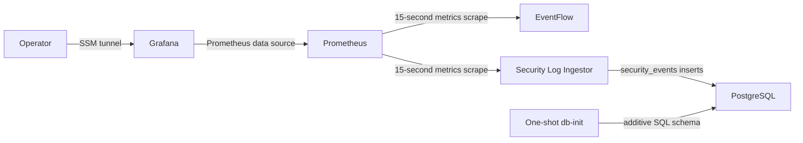

# Platform Engineering Lab — AWS deployment handoff

Phase 2 preparation is recorded in [the approval review](AWS_PHASE2_REVIEW.md),
including a fresh SSM capacity check and deployment/rollback runbooks. This
handoff remains the historical infrastructure record; the local preparation
commit has not been pushed and applications remain undeployed.

## Current status

Last verified **2026-10-29**. The approved AWS infrastructure was applied:
**12 resources added, 0 changed, 0 destroyed**. EC2 status checks, SSM shell
connectivity, bootstrap completion, and Budget notification configuration passed.
**Application deployment has not started.** The EC2 Docker host had no containers
at verification. The existing local Docker environment and PostgreSQL data were
not modified.

This document summarizes the recorded deployment; it does not perform a fresh
live AWS check. Detailed evidence and supporting resource IDs are in the
[deployment report](../infra/terraform/aws/DEPLOYMENT_REPORT.md).

## AWS infrastructure

| Setting | Value |
| --- | --- |
| Account | `598387452073` |
| AWS CLI profile | `platform-lab` |
| Compute region / availability zone | `us-east-2` / `us-east-2a` |
| EC2 | `i-0ae38585502b57a05`, `t3.small`, 2 vCPU / 2 GiB |
| AMI | `ami-0c7dc2f4e28e6e66e`, AWS-owned Amazon Linux 2023 x86_64 |
| Root EBS | `vol-03ed5c59de967fd43`, encrypted 30 GiB gp3 |
| VPC | `vpc-0e2124bd3968ce471`, `10.42.0.0/16` |
| Subnet | `subnet-0b8d5fa7c20dfd096`, `10.42.1.0/24` |
| Internet gateway | `igw-0aeb2dfbc8e9245ac` |
| Route table / association | `rtb-0ad3b03e8360e47e3` / `rtbassoc-039201b5b410240c2` |
| Security group / HTTPS egress rule | `sg-060e335a3662e747b` / `sgr-09100096433a30bae` |
| IAM instance role | `platform-engineering-lab-3e3e5c4ef933ec20c00356e1c8` |
| Inline role policy | `session-manager-only` |
| Instance profile | `platform-engineering-lab-c47ac8d72882e0643c077261c6` |
| Budget | `platform-engineering-lab-account-monthly` |

EBS is nested in the EC2 Terraform resource. The VPC and EC2 also created default
VPC objects and a network interface; their IDs are recorded in the deployment
report. There is no NAT gateway, load balancer, RDS, EKS, or Elastic IP.

Bootstrap verified Docker Engine **25.0.18**, Compose **v5.1.1**, Buildx
**v0.38.1**, and SSM Agent **3.3.5390.0**. Docker and SSM were active; cloud-init
finished successfully. Installed tooling does not establish application health
or image-build compatibility; those checks remain for the next phase.

## Terraform state and approval record

Terraform lives in [`infra/terraform/aws/`](../infra/terraform/aws/README.md).
Validation/apply used **Terraform 1.17.1** and **AWS provider 6.71.0**, pinned by
`.terraform.lock.hcl`. The temporary Terraform binary used locally is
`/tmp/platform-terraform-bin/terraform`; temporary tooling may disappear.

- State: `infra/terraform/aws/terraform.tfstate`, local backend, mode **0600**.
- Inputs: `infra/terraform/aws/terraform.tfvars`, mode **0600**, explicitly selects
  `platform-lab`, `us-east-2`, account allowlist `["598387452073"]`, and the Ohio AMI.
- Applied plan: `infra/terraform/aws/review.tfplan`, mode **0600**. Its approved
  SHA-256 was:

  ```text
  dd196ee778b8e77f6d37339516078e0948c22c47e87954c9b15df988477c1fa8
  ```

- State, plans, `.terraform/`, and private variable files are ignored by Git.
  Keep them out of source archives and container build contexts. Commit the
  provider lock file and reviewed infrastructure code, not private artifacts.
- There is no remote state backend or shared locking service. Securely back up
  state and coordinate operators. Do not remove state or treat this deployment
  as a new empty environment.
- The saved plan is **already applied and historical**. Do not reuse it or the
  archived failed/previous-account plans. Future infrastructure changes require
  fresh identity verification, a new plan, review, and explicit approval.

The earlier `us-east-1` plan was denied by organization SCP `p-pm6bklp3`.
Ohio reads and the approved apply succeeded; no SCP or IAM workaround was used.
The separate `aws.billing` provider uses the same profile/account restriction
with the global billing endpoint in `us-east-1`; compute remains in Ohio.

## Five-service application architecture

The AWS deployment merges [`compose.yaml`](../compose.yaml) with
[`infra/deploy/compose.aws.yaml`](../infra/deploy/compose.aws.yaml). The override
adds a separate PostgreSQL service and project-owned database network. It does
not reuse or migrate the existing local PostgreSQL container or its volume.



| Service | Entry point / access on EC2 | Persistence |
| --- | --- | --- |
| EventFlow | `app.main:app`; loopback `8001` → container `8000` | Events are process-memory only |
| Security Log Ingestor | `main:app`; loopback `8002` → container `8000` | `public.security_events` in PostgreSQL |
| PostgreSQL 16.15 | Internal port `5432`; no published host port | `platform-engineering-lab_postgres_data` |
| Prometheus 3.15.1 | Loopback `9090` | `platform-engineering-lab_prometheus_data` |
| Grafana 13.3.0 | Loopback `3000` | `platform-engineering-lab_grafana_data` |

`db-init` is a sixth Compose entry but a one-shot task, not a long-running
application. It runs the transactional, repeatable
[`001_security_events.sql`](../database/init/001_security_events.sql) after
PostgreSQL is healthy. The ingestor starts after initialization succeeds.
Existing data is not dropped or replaced; incompatible schemas need separate
reviewed migrations.

Prometheus reaches `eventflow:8000/metrics` and `log-ingestor:8000/metrics` over
Docker networks every 15 seconds. The AWS override retains metrics for 15 days
or approximately 2 GB, with additional space needed for head/WAL and other data.
Grafana provisions its Prometheus data source and **Platform Engineering Lab —
Observability** dashboard, UID `platform-lab-observability`. Availability panels
show scrape success; PostgreSQL readiness is checked separately at `/ready`.

## Deployment and verification scripts

| File | Purpose |
| --- | --- |
| [`templates/bootstrap.sh`](../infra/terraform/aws/templates/bootstrap.sh) | Applied user data: installs/enables tooling, verifies Compose/Buildx checksums, bounds Docker logs, creates AWS-host marker |
| [`common.sh`](../infra/deploy/common.sh) | Requires root, AWS marker, and checkout at `/opt/platform-engineering-lab`; selects both Compose files |
| [`deploy.sh`](../infra/deploy/deploy.sh) | Generates host-only secrets once, builds applications serially, starts PostgreSQL, initializes schema, starts services, runs checks |
| [`check-config.py`](../infra/deploy/check-config.py) | Read-only AWS Compose configuration assertions; does not start containers |
| [`smoke-test.py`](../scripts/smoke-test.py) | Tests application endpoints, ingestion/validation, and metrics; retains one labeled database test event per run |
| [`observability-check.py`](../scripts/observability-check.py) | Generates sample traffic and verifies scraping, Grafana provisioning, and real dashboard queries without database writes |
| [`backup.sh`](../infra/deploy/backup.sh) | PostgreSQL logical dump, secrets/revision metadata, and consistent Grafana/Prometheus volume archives |

On first deployment, `deploy.sh` creates `/opt/platform-engineering-lab/.env`
with random PostgreSQL/Grafana passwords, root-owned mode **0600**. Updates keep
that file and the Docker volumes. Editing `.env` does not rotate existing
PostgreSQL or Grafana passwords. Do not print secrets in logs or commit them.

Do not run the AWS Compose override or deployment/backup scripts against the
workstation's existing Docker lab. They are intended for the dedicated EC2 host.
Use both Compose files for all remote stack administration.

## Security and operator access

- No inbound security-group rules, SSH key, or public service endpoints.
- Outbound internet TCP **443** only; the dynamic public IPv4 is for egress.
- IMDSv2 required, hop limit **1**. Bridged applications intentionally cannot
  obtain instance-role credentials and do not require AWS API access.
- The instance role permits only SSM registration and four session-channel
  actions; it has no application AWS permissions.
- Root EBS is encrypted using AWS-managed EBS KMS protection. All future Docker
  volumes live on this root disk.
- CPU credit mode is **standard**, avoiding unlimited surplus-credit charges.
- Session Manager operator permissions are distinct from the instance role.
  Do not open public ports to troubleshoot SSM or application failures.

The following commands are operator instructions, not actions performed by this
handoff task. Verify identity before any AWS work:

```bash
aws sts get-caller-identity --profile platform-lab --region us-east-2
aws ssm start-session --profile platform-lab --region us-east-2 --target i-0ae38585502b57a05
```

Session Manager plugin **1.2.896.0** was staged locally under `/tmp`. If still
present, add `/tmp/platform-session-manager/usr/local/sessionmanagerplugin/bin`
to PATH; otherwise install the official plugin before opening CLI sessions.

After applications are deployed, forward Grafana without conflicting with the
existing local Grafana on port 3000:

```bash
aws ssm start-session --profile platform-lab --region us-east-2 \
  --target i-0ae38585502b57a05 \
  --document-name AWS-StartPortForwardingSession \
  --parameters '{"portNumber":["3000"],"localPortNumber":["13000"]}'
```

Then open `http://localhost:13000/d/platform-lab-observability` while the tunnel
is active. There is currently no deployed Grafana application to connect to.

## Cost and Budget

The reviewed Ohio estimate, using 730 running hours/month, is **$21.23/month**:
EC2 $15.18, 30 GiB gp3 $2.40, and public IPv4 $3.65. Taxes, transfer beyond shared
allowances, extra storage/snapshots, and other account activity can add charges.
EBS remains billable when EC2 is stopped. These are recorded planning estimates,
not a current bill. Pricing sources and assumptions are in the
[AWS guide](../infra/terraform/aws/README.md#account-free-tier-and-expected-cost).

Before apply, AWS reported an active Free plan with **$100** remaining and
account-plan expiration **April 29, 2027**. That balance is not rechecked here;
confirm current balance and individual credit eligibility/expiration in Billing.

Verified Budget: **$25 USD/month**, account-wide, with one **100% ACTUAL**
`GREATER_THAN` notification to **anand.sandhinti@mandsconsulting.com**. Credits
and refunds are excluded so promotional credits do not mask usage costs. No
forecast alert is configured. Notification configuration was verified, not inbox
delivery. Alerts are delayed notifications, not a spending cap or automatic stop.

## Remaining tasks and stop boundary

1. Confirm the next application-deployment phase. Infrastructure approval has
   been executed; no application deployment should be inferred from this handoff.
2. Review and publish a complete source revision. Deployment files, Compose,
   instrumentation, and infrastructure changes remain uncommitted/untracked;
   the documented Git clone cannot retrieve this working tree until published.
3. Securely back up Terraform state. Keep state, private variables, plans, and
   credentials out of the published revision and deployment source bundle.
4. Through SSM, place the reviewed checkout at `/opt/platform-engineering-lab`
   and run `sudo bash infra/deploy/deploy.sh` on EC2. No local volume migration is
   intended. Any transfer of existing local records requires separate planning.
5. Verify all five services and the completed initializer; check EventFlow
   `/health` and `/events`, ingestor `/health`, `/ready`, and `/events`, both
   `/metrics` endpoints, Prometheus targets, and Grafana data source/dashboard.
6. Run the existing smoke/observability checks on EC2 and record their results.
   Verify Grafana through SSM port forwarding; keep public ingress closed.
7. Exercise backups and restoration before relying on persistent data. Investigate
   image-build/runtime compatibility, memory pressure, disk growth, and any new
   permissions errors during this phase without weakening security controls.

There were no Terraform apply errors or unresolved bootstrap errors. The Budget
verifier was corrected to handle an omitted optional API field and AWS's `25.0`
amount normalization; final checks passed. Runtime applications, image builds,
smoke tests, dashboard access, and backup restoration remain unverified on AWS.

## Persistence and destructive-change precautions

Application updates should rerun the deployment script with the same Compose
project, secrets file, and volumes; they do not require rebuilding AWS resources.
EventFlow's in-memory events still disappear on process restart.

Root EBS has `delete_on_termination = true`. Instance replacement or Terraform
destroy deletes PostgreSQL records, Grafana data/users, Prometheus history,
host secrets, and on-host backups. Before any separately approved destructive
action, run the backup script on EC2, copy the resulting secret-containing
archives off-host to encrypted storage, verify checksums, and test restoration.
The backup script briefly stops/restarts Grafana and Prometheus for consistent
archives; PostgreSQL stays running. A backup on the root disk alone is insufficient.
Do not use `docker compose down -v` as troubleshooting.

No infrastructure changes, AWS calls, or container operations were performed
to create this handoff document.
