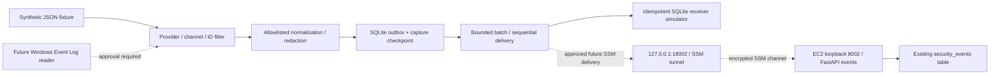

# Phase 3: Windows 11 security collector — local prototype

Status: local, synthetic-only implementation with idempotent ingestion. An additive
migration and ingestor update are prepared and tested against disposable local
PostgreSQL, including loopback HTTP timeout/restart tests. The first approved AWS
rollout applied migration 002 and then restored the prior API after a verification
error. Its four-record database and schema are retained. No real Windows logs or
ongoing collector delivery have been enabled. See the corrected
[retry plan](PHASE3_ROLLOUT_PLAN.md) before redeployment. Windows acquisition remains
design work; the current corrections are local only.

## API review completed before implementation

Reviewed [`SecurityEvent` and `POST /events`](../services/log-ingestor/main.py),
[`001_security_events.sql`](../database/init/001_security_events.sql), Compose,
the AWS handoff, and Phase 2 review. The handoff/review record predeployment
history; the stack has since been deployed successfully.

| Existing field | Type / handling in this collector |
| --- | --- |
| `source_event_id` | Optional API string, required for safe collector retries; `winsec:v1:` + stable SHA-256 |
| `timestamp` | Required datetime; collector requires an offset and emits ISO 8601 |
| `service` | Required string: `windows-security-collector` |
| `event_type` | Required string, from the policy below |
| `severity` | Required string; API uppercases and validates five allowed levels |
| `source_ip` | Optional IPv4/IPv6; always null in the prototype |
| `username` | Optional string; always null in the prototype |
| `message` | Required string; generated summary and deterministic source key |

The API accepts **one object per request**, not a list. A successful POST commits
one row and returns HTTP 200 with `status=stored` and an integer `event_id`, plus
service/type/severity. Validation returns 422; database failures return 500.
`/health` is liveness; `/ready` verifies PostgreSQL/schema and the unique constraint
before advertising `capabilities.source_event_id = "v1"`. Keyed requests return
the same ID and echo `source_event_id` on replay; changed content with the same
ID returns 409. IDs are globally unique, case-sensitive, and namespaced by the
producer. Omitted/null identifiers retain legacy insert-per-request behavior.
The API has no security-event GET endpoint, application authentication, or batch
endpoint. `raw_event` stores the validated payload; redact before sending.

## Architecture and privacy



The default CLI remains offline and has no Windows API, AWS SDK, endpoint option,
or subprocess calls. The SQLite receiver simulates the idempotent API. A separate
`local_transport.py` adapter supports loopback HTTP only, disables proxies and
redirects, and verifies readiness capabilities before delivery. It is used only
against a disposable local FastAPI/PostgreSQL stack in integration tests. There
is no automatic SSM session or AWS mode. `synthetic=true` is a fixture convention,
not proof that user-supplied content is synthetic; use deliberately fabricated data.

Initial policy `synthetic-security-v2`:

| Channel / provider | Event | Selection | Type / severity |
| --- | --- | --- | --- |
| Security / Microsoft-Windows-Security-Auditing | 4624 successful logon | Logon types 2, 7, 10, 11 only | windows.logon_success / INFO |
| Security / Microsoft-Windows-Security-Auditing | 4625 failed logon | All logon types | windows.logon_failure / WARNING |
| Security / Microsoft-Windows-Eventlog | 1102 audit log cleared | All | windows.audit_log_cleared / CRITICAL |

Other channels, providers, IDs, and successful network logons are filtered out.
Process creation (4688) is excluded initially because of volume and potentially
sensitive command lines. Event meanings follow Microsoft's
[4624 reference](https://learn.microsoft.com/en-us/previous-versions/windows/it-pro/windows-10/security/threat-protection/auditing/event-4624)
and [Windows auditing guidance](https://github.com/MicrosoftDocs/windowsserverdocs/blob/main/WindowsServerDocs/identity/ad-ds/plan/security-best-practices/advanced-audit-policy-configuration.md).
Selection is a lab policy, not a complete detection strategy. Review it before
collecting real events; collection only sees events enabled by Windows audit policy.

Normalization constructs a new payload. It never copies raw XML, rendered
messages, EventData, usernames, domains, SIDs, hostnames, command lines, paths,
tokens, passwords, or source IP addresses. Source identities use an assigned
nonidentifying host alias, channel, log generation, and EventRecordID; their
SHA-256 digest is included in the summary for reconciliation. This digest is an
identity token, not anonymization of arbitrary personal data. The stable host
alias and generation stay local. Timestamps and event types still reveal activity.
No payloads or exception bodies are printed; stdout contains counts only.

Future production summaries must remove the `Synthetic` prefix through an
explicit mode/policy change, not by relabeling real events as synthetic.

## Durable checkpoints, batches, and retry semantics

`collectors/windows_security/collector.py` stores a capture checkpoint per
host-alias/channel/generation and a durable outbox in SQLite. Redacted payload
staging and capture-checkpoint advancement share a transaction. Filtered entries
also advance the capture checkpoint. Acknowledgements are separate: moving the
capture checkpoint means data is durably queued, not that AWS received it.
Restart resumes pending entries; a repeated fixture does not queue them again.

One ordered source stream is allowed per capture chunk. Invalid input, unordered
IDs, or capacity exhaustion rolls back the whole chunk. The queue limit is
10,000 unacknowledged events; a fixture is limited to 256 KiB / 1,000 entries.
Each invocation delivers at most 20 events / 64 KiB (configurable count 1–100),
sequentially, as individual simulated POSTs. There is no request-array batching.
The CLI exits after one batch; rerun it to drain additional batches or due retries.
A future continuous worker should flush at the count/byte bound or every five
seconds, enforce a disk quota, and stop capture under backpressure.

| State / outcome | Behavior |
| --- | --- |
| pending | Durable; eligible after its retry deadline |
| sending | Committed locally before delivery |
| valid stored ACK with matching source ID | Save original receipt and mark acked atomically |
| connection failure, timeout, lost ACK, HTTP 5xx | Retry identical persisted payload/ID with backoff |
| interrupted sending / unknown | Requeue only after verifying idempotency capability |
| 409, 422, other permanent 4xx, redirect | Block and retain; operator review |
| retry budget exhausted | Block and retain; operator review |

Backoff is 0.5 seconds doubling to 30 seconds before 50–100% jitter; default budget
is five attempts across invocations, including interrupted sends. FIFO prevents
later events overtaking a waiting retry. Unacknowledged and acknowledged records
are retained; there is no automatic deletion. Monitor disk use and plan compaction.
A lock file prevents concurrent collectors using the same state.

Stable IDs hash nonidentifying host alias, channel, generation, and EventRecordID,
then add the `winsec:v1:` namespace. They do not include delivery time, process ID,
random retry tokens, or payload content. The outbox persists the exact payload and
ID so restart never regenerates them. Distinct hosts require distinct aliases;
log-generation changes require explicit recovery review. Duplicate detection is
now database-enforced rather than dependent on a local checkpoint alone.

Capability checks prevent delivery to the old API, which would silently ignore
unknown JSON fields. The server echoes the key in successful acknowledgements.
An uncertain commit can therefore be replayed against the verified new API: the
unique constraint prevents a second row and the original database ID is returned.
Conflicts retain the original record unchanged. Unknown programmer errors remain
visible in state and can only replay after capability verification.

Old `synthetic-security-v1` outboxes are intentionally rejected rather than
silently upgrading unkeyed payloads. Do not change their policy string or fabricate
keys for already-sent records. Preserve/reconcile them first. Old server records
with null IDs cannot be deduplicated retroactively; replaying them with new IDs
would create new records. See the migration review for rollout and rollback order.

## Future Windows 11 adapter — not implemented or executed

Use Windows Event Log APIs (`EvtQuery`/`EvtNext` or `EvtSubscribe`) and provider
XML fields, not localized rendered text. Query the local Security channel with
an allowlist XPath, then repeat provider/logon-type filtering in normalization.
Read forward in bounded chunks and persist the native XML bookmark alongside
the corresponding staged payloads in one transaction. Resume after the bookmark.
Microsoft documents [queries](https://learn.microsoft.com/en-us/windows/win32/wes/querying-for-events)
and [persistent bookmarks](https://learn.microsoft.com/en-us/windows/win32/wes/bookmarking-events).
The prototype's numeric checkpoint models one synthetic log generation; it is
not a native Windows bookmark implementation.

Use a dedicated account with only the channel-read rights needed; verify actual
Security-channel ACL access rather than granting full administrator rights by
default. Do not change auditing policy or permissions automatically. Choose an
explicit approved start position (now vs bounded historical lookback). Missing
bookmarks, retention gaps, log clearing, restored logs, and record-ID reuse must
raise an operator-visible gap condition. Do not silently skip or reset to zero.
A new generation is an explicit recovery decision, not the Windows boot ID.

Run one collector per protected state directory. The prototype uses an exclusive
lock file. An abrupt process death leaves the lock; verify the owning process is
gone before manually removing only the lock. Startup changes interrupted sending
records to unknown. Never delete the SQLite databases as a restart procedure.
Use an NTFS directory ACL limited to the collector account and administrators
before Windows use; POSIX directories are created with mode 0700, but Windows
requires its own ACL configuration. Do not sync state to Git/cloud folders. A
custom `--state-dir` must also be outside source control and image build contexts.

## Secure private transport — future approved step only

Keep EC2 ingress closed and the existing ingestor publication on **127.0.0.1:8002**.
The planned path is Windows loopback `127.0.0.1:18002` → AWS Session Manager
encrypted data channel → EC2 loopback `8002` → existing ingestor container.
No public API, load balancer, PostgreSQL port, or Docker network change is needed.
AWS documents the port-forwarding parameters in
[Start a session](https://docs.aws.amazon.com/systems-manager/latest/userguide/session-manager-working-with-sessions-start.html).

After separate approval, verify AWS identity/profile `platform-lab`, account
`598387452073`, region `us-east-2`, target `i-0ae38585502b57a05`. Install/verify the
official AWS CLI and Session Manager plugin on Windows; use short-lived operator
credentials. A proposed PowerShell command (not executed) is:

```powershell
aws ssm start-session --profile platform-lab --region us-east-2 `
  --target i-0ae38585502b57a05 `
  --document-name AWS-StartPortForwardingSession `
  --parameters 'portNumber=8002,localPortNumber=18002'
```

Verify the actual local listener is loopback-only before sending; do not expose it
through portproxy, firewall exceptions, LAN binding, or a shared remote desktop.
The loopback HTTP adapter uses only `127.0.0.1`, disables HTTP proxies and
redirects, uses bounded request timeouts, and verifies `/ready` capabilities before
each batch. SSM delivery remains subject to separate approval. Liveness/readiness alone does not
authenticate an unexpected local listener; supervise the tunnel, detect port
collisions, and stop delivery on tunnel exit. Treat same-host untrusted processes
as a risk: the existing API has no application authentication. For a shared or
untrusted workstation, design application authentication before real collection.

SSM authenticates the operator opening the tunnel, not each HTTP caller. Scope
operator permissions to the target instance and approved session document, with
own-session cleanup and bounded lifetime. The standard document permits a port
parameter; target scoping alone does not restrict it to 8002. If strict port
restriction is required, separately review a custom port-session document with
an allowed value of 8002 and matching IAM permissions. Do not broaden the EC2 role,
grant application AWS credentials, or modify IAM during this local phase.

Keep credentials out of configuration, code, outbox, and logs. SSM API audit
records establish session activity, not event-level delivery receipts. Protect
and review collector counts/receipts separately. Close the tunnel when finished;
no direct/public fallback is permitted when it is unavailable.

## Local run and validation

Runtime: Python 3.10+ standard library; no additional runtime dependencies.
From the repository root, on Linux or Windows with the corresponding Python:

```bash
python3 -m collectors.windows_security.collector
# First invocation: staged=3, acknowledged=3; two fixture entries filtered.
python3 -m collectors.windows_security.collector
# Repeated invocation: staged=0, acknowledged=0; acked remains 3.
```

On Windows use `py -3 -m collectors.windows_security.collector`. Default state is
`.collector-state/`, excluded from Git and Docker build contexts. Counts/receipts
persist locally; neither command connects to the ingestor or PostgreSQL.

To demonstrate failure cases use a **fresh disposable state directory** for each
scenario, never a new directory to evade an existing delivery uncertainty:

```bash
python3 -m collectors.windows_security.collector --state-dir /tmp/collector-retry-demo --simulate-failure before-send
# Exit 2, pending. After backoff, rerun without the failure flag: three ACKs.
python3 -m collectors.windows_security.collector --state-dir /tmp/collector-unknown-demo --simulate-failure after-commit
# Exit 2, pending. After backoff, rerun without the flag: original receipt, no duplicate.
```

Collector unit tests use unittest and Pydantic. They compile the actual model in
isolation; they do not start an application or database:

```bash
.venv/bin/python -m unittest collectors.windows_security.test_collector -v
```

For complete local validation install `tests/requirements.txt` into a virtual
environment, then run `bash scripts/test-phase3-local.sh`. This creates a separate
PostgreSQL container with RAM-backed data and a random loopback port, runs unit
and API integration tests, and removes only that disposable container. It never
loads `.env` or touches existing containers/volumes. Docker and loopback socket
access are required.

Validation covers the actual API model, filtering/redaction, bounded batches,
checkpoint replay/restart, retry budgets, database uniqueness, concurrent duplicates,
conflicting payloads, migration repeatability/legacy preservation, capability gates,
and a real HTTP response timeout after PostgreSQL commit followed by restart/retry.
Live Windows capture, NTFS permissions, SSM transport, and sustained capacity
remain unvalidated. Test records are synthetic and disposable.

## Approval boundary and next review

Review source and policy locally first. Before real collection or AWS delivery,
approve data selection/redaction, Windows account/ACLs/start position, retention,
the prepared migration/compatibility plan, and a bounded AWS synthetic integration trial.
Any API/schema migration needs its own reviewed rollout and rollback preserving
existing data. Changes are prepared for a local release commit; see the
[rollout approval plan](PHASE3_ROLLOUT_PLAN.md). No push, deployment, AWS
session, IAM/Terraform change, existing service rebuild/restart, or real log capture was
performed for this phase. Disposable test containers are the only containers started.
